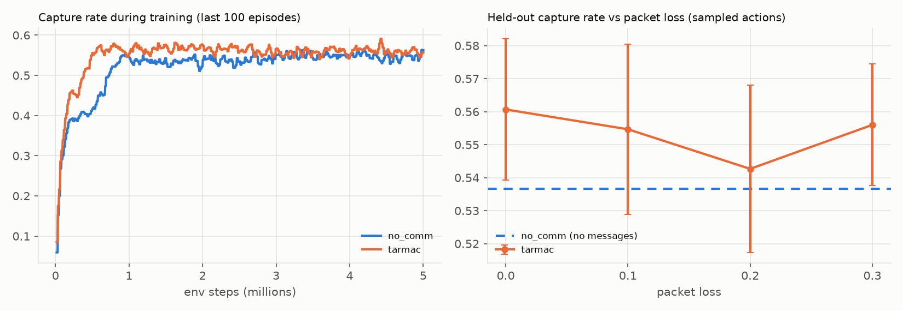

# M3 result: TarMAC-MAPPO (learned targeted communication)

| | |
|---|---|
| Job | `dynabelief-tarmac-s0-20261010-163342` (SageMaker `ml.g4dn.8xlarge`, Tesla T4, 16 env workers) |
| Code | `8035b23` |
| Config | `configs/tarmac.yaml` = `no_comm.yaml` + TarMAC (key 16 + value 16 floats per message), trained lossless; seed 0, deterministic GPU kernels |
| Training | 5.0M env steps in 1.8 h (773 env steps/s, 2.2 s per update); peak VRAM 1.55 GB |
| Cost | 1.93 billable h × $2.72/h ≈ **$5.2** |

## Held-out evaluation

50 episodes, identical to the M2 baseline's (same seeds). Δ = per-episode paired difference from
No-Comm, 95 % CI. Messages are counted per directed link (8 agents → 56 links per step).

| Method | Packet loss | Capture rate | Δ vs No-Comm (paired) | Evaders / episode | Time to capture | Messages delivered / step |
|---|---|---|---|---|---|---|
| No-Comm (M2) | – | 0.537 ± 0.026 | – | 16.1 | 195 | – |
| TarMAC | 0 | 0.561 ± 0.021 | +0.024 ± 0.032 | 16.8 | 194 | 55.9 |
| TarMAC | 0.1 | 0.555 ± 0.026 | +0.018 ± 0.038 | 16.6 | 192 | 50.3 |
| TarMAC | 0.2 | 0.543 ± 0.025 | +0.006 ± 0.038 | 16.3 | 195 | 44.7 |
| TarMAC | 0.3 | 0.556 ± 0.018 | +0.019 ± 0.033 | 16.7 | 192 | 39.1 |
| TarMAC, greedy actions | 0 | 0.441 | – | 13.2 | 170 | 55.9 |

Bytes per capture (sampled, loss 0): ≈ 213 KB.

## Observations

1. **Faster, not higher.** TarMAC reaches the plateau about twice as fast (capture rate 0.556 at
   0.5M steps vs 0.416 without messages), but the final level is the same: +0.024 at loss 0, and
   every paired confidence interval includes 0.
2. **Insensitive to packet loss up to 30 %.** Combined with (1), the messages TarMAC learns from
   reward alone carry little information the policy depends on at the end of training. This is the
   motivating gap for belief supervision (DIABL, M4): give the channel an explicit job.
3. **Attention becomes targeted:** mean attention entropy falls from 1.31 to 0.76 nats (uniform
   over 7 senders = 1.95), so receivers learn to focus on a few senders.
4. **Greedy actions hurt TarMAC** (0.441 vs 0.561 sampled), unlike No-Comm (0.553 vs 0.537).
   One plausible cause: deterministic agents that read the same messages move in lockstep and get
   stuck; the stochastic policy breaks ties. Report sampled actions as the main number.

One seed. The three-seed comparison happens in M7.
