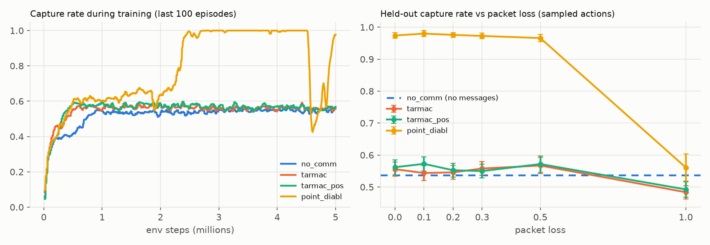
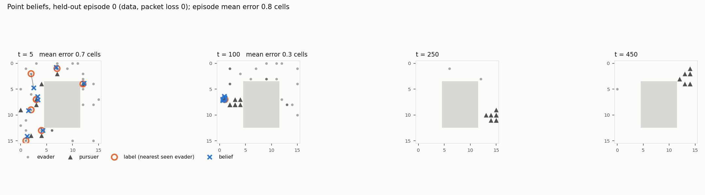

# M4 result: point-belief DIABL + uniform InfER

**Question:** does supervising each agent's belief about the nearest seen evader *through the
communication channel* (DIABL), with replay of first-discovery events (InfER), make
communication useful in Pursuit?

| Run | Job | Instance | Code | Train time | Cost |
|---|---|---|---|---|---|
| `tarmac_pos` (control: TarMAC + own position) | `dynabelief-tarmac-pos-s0-20261010-172533` | `ml.g5.8xlarge` (A10G) | `3628b49` | 2.0 h | $6.2 |
| `point_diabl` (control + point belief + InfER) | `dynabelief-point-diabl-s0-20261010-172552` | `ml.g4dn.16xlarge` (T4) | `3628b49` | 2.5 h | $13.5 |

Both runs: 5.0M env steps, seed 0, deterministic kernels; the configs differ only in `belief` and
`replay` ([D32](../decisions.md)). The two ran on different GPU types at the same time (quota):
that changes floating-point details, not the method. Evaluations: CPU eval-only jobs (code
`07ab675`, `29744fc`), 50 held-out episodes identical for every row, sampled actions
([D36](../decisions.md)). Δ = paired per-episode difference from `tarmac_pos`, 95 % CI.

## Held-out results

| Method | Packet loss | Capture rate | Δ vs control (paired) | Evaders / episode (of 30) | All 30 caught | Time to capture |
|---|---|---|---|---|---|---|
| No-Comm (M2) | – | 0.537 ± 0.026 | −0.025 ± 0.036 | 16.1 | 0 % | 195 |
| TarMAC (M3) | 0 | 0.556 ± 0.023 | −0.006 ± 0.021 | 16.7 | 0 % | 192 |
| control `tarmac_pos` | 0 | 0.562 ± 0.023 | – | 16.9 | 0 % | 191 |
| control `tarmac_pos` | 1.0 | 0.493 ± 0.024 | – | 14.8 | 0 % | 193 |
| **point DIABL** | 0 | **0.974 ± 0.008** | **+0.412 ± 0.026** | 29.2 | 48 % | 138 |
| **point DIABL** | 0.1 / 0.2 / 0.3 | 0.980 / 0.976 / 0.973 | +0.41 / +0.42 / +0.42 | 29.2–29.4 | 46–64 % | 139–143 |
| **point DIABL** | 0.5 | 0.966 ± 0.011 | +0.394 ± 0.030 | 29.0 | 40 % | 139 |
| point DIABL | **1.0 (no messages)** | 0.561 ± 0.042 | +0.069 ± 0.050 | 16.8 | 0 % | 228 |
| point DIABL, `best.pt` (early stopping) | 0–0.5 | **1.000** | – | 30.0 | **100 %** | 137–145 |
| point DIABL, `best.pt` | 1.0 | 0.707 | – | – | 0 % | 175 |

## Beliefs

Euclidean error of each agent's belief vs the label, in grid cells (lower is better), with naive
references: guessing one's own position, or the grid centre. *Remote-only* = labels outside the
agent's own view, which only teammates' messages can locate (about 11 % of labelled steps).

| Packet loss | Belief error | Own-position guess | Centre guess | Remote-only error | Remote-only own-position guess |
|---|---|---|---|---|---|
| 0 | **0.77** | 1.90 | 6.81 | **2.35** | 5.19 |
| 0.5 | 0.84 | 1.97 | 6.78 | 2.60 | 5.16 |
| 1.0 (no messages) | 1.24 | 2.00 | 6.45 | **6.02** | 6.41 |

## Observations

1. **Large, significant gain:** +0.41 capture rate over the matched control at every packet
   loss up to 50 %; nearly every evader is caught (29.2 of 30) and episodes end early. TarMAC
   without belief supervision, with or without own position, stays at ~0.56.
2. **The gain comes from communication.** With every message dropped, DIABL falls back to the
   control's level (0.561, +0.07 ± 0.05), and its remote-only belief error rises from 2.35 to
   6.02 cells, the level of a naive guess. Belief supervision made the channel carry evader
   locations: exactly the DIABL mechanism, now for moving targets.
3. **Robust to unseen loss:** trained lossless, it keeps 0.966 at 50 % loss. Fewer messages still
   carry enough location information because every agent broadcasts what it sees.
4. **Emergent behaviour:** the pursuers move as one pack (see the t = 100 panel), steered by the
   shared beliefs, and capture in surround formation.
5. **Late-training instability:** the training curve holds 1.000 from ~2.9M to 4.5M steps, then
   collapses to 0.45 at 4.55M and recovers to 0.98 by 5M. The collapse coincides with simultaneous
   spikes in KL, belief loss and actor gradient norm; smaller spikes recur (updates ~400, 800,
   1000, 1040, 1100). Lead (unverified): the 20 belief-only replay steps per update on the shared
   network, replaying windows whose stored hidden states come from older networks. `best.pt` (the
   peak training window, i.e. early stopping) reaches 1.000 held-out; `final.pt` 0.974.
6. **Greedy actions collapse DIABL** (0.048 capture rate; TarMAC: 0.441). The learned policy needs
   its stochasticity (entropy ≈ 1.0 nats at the end). Sampled actions are the valid evaluation.
7. Receivers attend almost uniformly (attention entropy ≈ 1.75 nats vs 0.76 for TarMAC): with
   belief supervision every sender's report matters.

**Caveats:** one seed per method; own-position input for M4 only (D32: decide for M7 whether
all methods get it); the instability and the greedy collapse need follow-up before M7.
