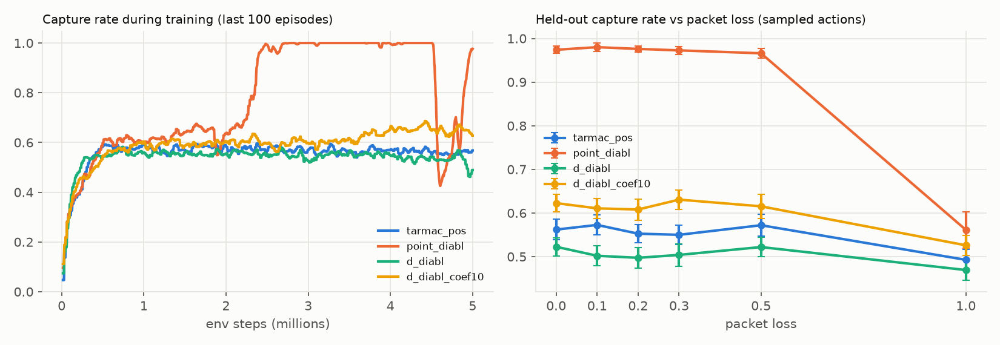
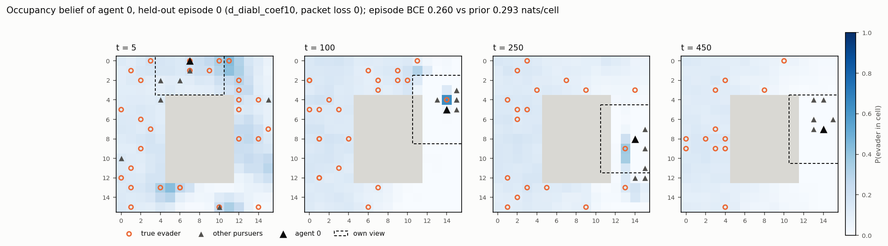
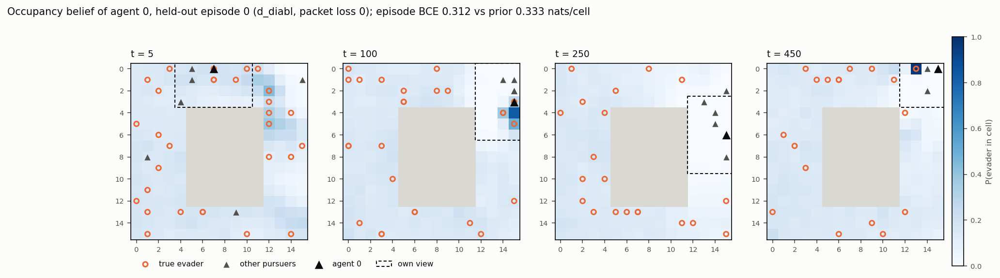

# M5 result: D-DIABL (occupancy-map belief) + uniform InfER

**Question:** does a per-cell probability map of where the evaders are, trained through the
communication channel, help as much as the single-point belief of M4, and is the map calibrated?

| Run | Job | Instance | Code | Train time | Cost (incl. evals) |
|---|---|---|---|---|---|
| `d_diabl` (`belief.coef = 1`, as point DIABL) | `dynabelief-d-diabl-s0-20261011-100209` | `ml.g4dn.16xlarge` (T4) | `22f8d44` | 2.3 h | $13.1 |
| `d_diabl_coef10` (`belief.coef = 10`, D43) | `dynabelief-d-diabl-coef10-s0-20261011-100212` | `ml.g5.8xlarge` (A10G) | `22f8d44` | 2.5 h | $8.1 |

Both runs: `configs/d_diabl.yaml` (= `point_diabl.yaml` with `belief.type: map`), 5.0M env steps,
seed 0, deterministic kernels; the second adds `--set belief.coef=10` (now
`configs/d_diabl_coef10.yaml`). `belief.coef` weights only the belief term in the PPO update;
InfER replay keeps `replay.coef = 1`. Evaluations: in-job, 50 held-out episodes with the same
seeds as every M4 row, sampled actions (D36). Δ = paired per-episode difference from the M4
control `tarmac_pos` at the same packet loss, 95 % CI.

## Held-out results

| Method | Packet loss | Capture rate | Δ vs control (paired) | Evaders / episode (of 30) | Time to capture |
|---|---|---|---|---|---|
| control `tarmac_pos` (M4) | 0 / 1.0 | 0.562 / 0.493 | – | 16.9 / 14.8 | 191 / 193 |
| point DIABL (M4) | 0 | 0.974 ± 0.008 | +0.412 ± 0.026 | 29.2 | 138 |
| point DIABL (M4) | 1.0 | 0.561 ± 0.042 | +0.069 ± 0.050 | 16.8 | 228 |
| D-DIABL coef 1 | 0 | 0.523 ± 0.021 | −0.039 ± 0.032 | 15.7 | 196 |
| D-DIABL coef 1 | 0.1–0.5 | 0.497–0.522 | −0.046 … −0.071 | 14.9–15.7 | 188–197 |
| D-DIABL coef 1 | 1.0 | 0.469 ± 0.023 | −0.023 ± 0.032 | 14.1 | 191 |
| **D-DIABL coef 10** | 0 | **0.623 ± 0.020** | **+0.061 ± 0.032** | 18.7 | 175 |
| **D-DIABL coef 10** | 0.1–0.5 | 0.608–0.631 | +0.038 … +0.081 | 18.2–18.9 | 173–183 |
| D-DIABL coef 10 | 1.0 | 0.526 ± 0.023 | +0.033 ± 0.035 | 15.8 | 173 |
| greedy actions, coef 1 / coef 10 | 0 | 0.049 / 0.033 | – | 1.5 / 1.0 | – |

Full per-loss table: [m5_d_diabl_comparison.md](m5_d_diabl_comparison.md).

## Map quality

Mean binary cross-entropy per free cell and step (nats, lower is better) against the true
occupancy of all evaders, and two naive maps (D42): **prior** = the true current evader density
in every cell (an oracle constant: it knows how many evaders remain), **own view** = exact inside
the agent's own 7×7 view, prior elsewhere. *Remote* = cells outside the agent's own view. The
references depend on the episodes a policy produces (fewer evaders left → lower BCE), so compare
within a row.

| Run | Packet loss | Model | Own view | Prior | Remote: model | Remote: prior | Brier | ECE | Remote ECE |
|---|---|---|---|---|---|---|---|---|---|
| coef 1 | 0 | 0.300 | **0.293** | 0.323 | 0.336 | 0.342 | 0.086 | 0.009 | 0.011 |
| coef 1 | 1.0 | 0.316 | **0.301** | 0.331 | 0.353 | 0.352 | 0.090 | 0.012 | 0.014 |
| coef 10 | 0 | **0.261** | 0.265 | 0.292 | **0.295** | 0.309 | 0.074 | 0.003 | 0.004 |
| coef 10 | 0.5 | **0.266** | 0.268 | 0.295 | 0.300 | 0.312 | 0.075 | 0.003 | 0.004 |
| coef 10 | 1.0 | 0.305 | **0.287** | 0.314 | 0.344 | **0.336** | 0.086 | 0.031 | 0.034 |

Training belief loss (BCE, coef 10): 0.412 at start (= best constant, D41) → 0.330 (1.25M) →
0.297 (2.5M) → 0.276 (3.75M) → 0.260 (5M), still falling. Coef 1: 0.412 → 0.309, flat from ~3.75M.

## Observations

1. **coef 1 (as point DIABL): no gain.** Capture rate 0.523, slightly below the control at every
   loss up to 50 % (−0.04 … −0.07, all CIs exclude 0). The map is calibrated (ECE 0.009) but
   carries little information: it is worse than simply copying one's own view (0.300 vs 0.293),
   and its small remote advantage over the prior (0.006 nats/cell) vanishes with no messages.
2. **coef 10: a modest gain that needs messages.** +0.06 ± 0.03 capture rate over the control,
   positive at every loss up to 50 %, with captures 16 steps faster. Its map beats both naive
   maps, also on remote cells (0.295 vs 0.309), so teammates' messages now locate evaders the
   agent cannot see. With every message dropped the remote map becomes worse than the prior
   (0.344 vs 0.336) and miscalibrated (ECE 0.003 → 0.031): the policy and map rely on the
   channel. Its training window peaked at 0.69 near 4.4M steps and ended at 0.63.
3. **The point belief is far stronger** (0.974 vs 0.623). Explanation (not tested separately):
   the map target asks for all 30 randomly moving evaders, most of which nobody on the team has
   seen, so the loss is dominated by unpredictable cells and the best model improves on the
   prior by only ~10 % (0.261 vs 0.292). The point target puts the whole loss on one location
   that a teammate actually sees and that the team should move to. The early sender gradient
   was 2.7× smaller than point DIABL's (median 0.0036 vs 0.0097 over the first 100 updates;
   0.011 vs 0.015 at the end), which is why coef 10 matters.
4. **Maps are near the prior away from the pack** and sharp only at evaders someone sees
   (t = 100 panels). They do not spread probability around old sightings in a visible way;
   evaders move randomly, so a sighting is stale within a few steps.
5. **Greedy actions collapse** (0.03–0.05), as for point DIABL (D36). No late-training collapse
   like point DIABL's at 4.55M.
6. Attention entropy (median of the last 100 updates): 1.55 (coef 1) and 1.41 (coef 10) nats vs
   1.69 point DIABL and 0.85 `tarmac_pos`: belief supervision again spreads attention over senders.

**Caveats:** one seed per run; the two runs used different GPU types; coef 10 was not
converged at 5M steps and no other coefficient was tried; the single-target softmax ablation was
not run (D44); the explanation in 3 is a hypothesis.
